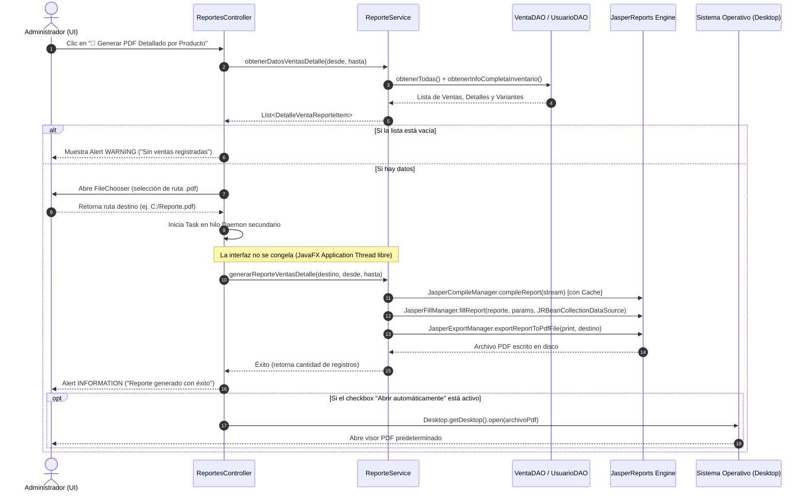

# Guía Integral de Estudio: Módulo de Reportes con JasperReports
**Proyecto:** TiendaZapatos (JavaFX + PostgreSQL + Hibernate + JasperReports)  
**Institución:** Universidad Americana (UAM), Managua, Nicaragua  
**Perfil:** Estudiante de Ingeniería de Sistemas  
**Rama de trabajo:** `feature/reporte-ventas`

---

## 1. ¿Qué es JasperReports y cómo funciona el flujo completo?

**JasperReports** es un motor de generación de reportes de código abierto en Java. Permite tomar datos estructurados (provenientes de una base de datos relacional, listas de objetos Java o colecciones de Beans) y plasmarlos en un documento listo para imprimir o distribuir (típicamente PDF).

### El ciclo de vida de un reporte (Flujo de 5 pasos)

```
 [1. Diseño]           [2. Compilación]           [3. Llenado (Fill)]          [4. Impresión]        [5. Exportación]
 Plantilla JRXML  ───►  JasperReport (.jasper) ──► JasperPrint (en memoria) ──► JasperViewer  ───► Documento PDF
 (XML declarativo)      (Bytecode Java / Obj)      (Plantilla + Datos)          (Previsualización)   (Archivo en disco)
```

1. **Diseño (.jrxml):** Es un archivo en formato XML que define la estructura visual del reporte: márgenes, título, encabezados de columnas, bandas de detalle, grupos y resúmenes de totales. Define qué parámetros recibirá y qué campos espera por cada registro.
2. **Compilación (`JasperCompileManager.compileReport`):** JasperReports toma el XML del `.jrxml`, valida su sintaxis y lo compila en un objeto binario en memoria de tipo `JasperReport`. En nuestro proyecto, esto se realiza dinámicamente y se almacena en un `ConcurrentHashMap` para evitar re-compilar en cada generación (optimización de caché).
3. **Fuente de Datos y Parámetros:**
   - **Parámetros (`Map<String, Object>`):** Datos globales y fijos que no cambian por fila (por ejemplo: nombre del negocio, fechas del filtro, usuario que generó el reporte, gran total).
   - **Fuente de Datos (`JRBeanCollectionDataSource`):** Colección de objetos Java (DTOs). JasperReports utiliza **reflexión** (`java.lang.reflect`) para invocar los *getters* de cada objeto coincidiendo con el nombre declarado en `<field name="...">`.
4. **Llenado (`JasperFillManager.fillReport`):** Fusiona la plantilla compilada (`JasperReport`) con los parámetros y la colección de datos (`JRBeanCollectionDataSource`). El resultado es un objeto `JasperPrint`, que contiene las páginas ya renderizadas con texto y coordenadas fijas en memoria.
5. **Exportación (`JasperExportManager.exportReportToPdfFile`):** Transforma el `JasperPrint` en un archivo binario `.pdf` guardado en la ruta elegida por el usuario.

---

## 2. Mapa de Archivos del Módulo de Reportes

A continuación se detalla cada archivo del proyecto que interviene en los reportes, su ubicación exacta y su responsabilidad:

| Archivo / Clase | Ruta en el Repositorio | Responsabilidad |
|---|---|---|
| **`ReportesView.fxml`** | `src/main/resources/ni/uam/edu/tiendazapatos/ReportesView.fxml` | Vista de interfaz gráfica (JavaFX). Define las tarjetas de reportes, selectores de fecha (`DatePicker`), botones de generación y etiquetas de conteo. |
| **`ReportesController.java`** | `src/main/java/ni/uam/edu/tiendazapatos/Controller/ReportesController.java` | Controlador de JavaFX. Captura los eventos de los botones, valida las fechas, abre el diálogo `FileChooser`, invoca la exportación en un hilo secundario (`Task`) y maneja alertas de éxito o error. |
| **`ReporteService.java`** | `src/main/java/ni/uam/edu/tiendazapatos/reportes/ReporteService.java` | Servicio de negocio. Orquesta la obtención de datos desde los DAO, construye los parámetros, compila las plantillas `.jrxml` con caché y ejecuta la exportación a PDF. |
| **`DetalleVentaReporteItem.java`** | `src/main/java/ni/uam/edu/tiendazapatos/reportes/DetalleVentaReporteItem.java` | **DTO nuevo:** Transporta una fila de detalle por producto vendido (factura, fecha, vendedor, producto, variante, cantidad, precio unitario, subtotal de línea). |
| **`VentaReporteItem.java`** | `src/main/java/ni/uam/edu/tiendazapatos/reportes/VentaReporteItem.java` | DTO existente: Transporta una fila resumen por cada factura emitida. |
| **`InventarioReporteItem.java`** | `src/main/java/ni/uam/edu/tiendazapatos/reportes/InventarioReporteItem.java` | DTO existente: Transporta datos de stock, modelos, tallas y valorización de calzado. |
| **`UsuarioReporteItem.java`** | `src/main/java/ni/uam/edu/tiendazapatos/reportes/UsuarioReporteItem.java` | DTO existente: Transporta la información de usuarios, roles y accesos. |
| **`ventas_detalle_reporte.jrxml`** | `src/main/resources/ni/uam/edu/tiendazapatos/reportes/ventas_detalle_reporte.jrxml` | **Plantilla JRXML nueva:** Diseño apaisado (*Landscape*) con agrupación por número de factura y detalle línea a línea por producto vendido. |
| **`ventas_reporte.jrxml`** | `src/main/resources/ni/uam/edu/tiendazapatos/reportes/ventas_reporte.jrxml` | Plantilla JRXML existente: Reporte resumido de ventas a nivel de factura. |
| **`inventario_reporte.jrxml`** | `src/main/resources/ni/uam/edu/tiendazapatos/reportes/inventario_reporte.jrxml` | Plantilla JRXML de catálogo y stock. |
| **`usuarios_reporte.jrxml`** | `src/main/resources/ni/uam/edu/tiendazapatos/reportes/usuarios_reporte.jrxml` | Plantilla JRXML de cuentas y roles de usuario. |
| **`VentaDAO.java`** | `src/main/java/ni/uam/edu/tiendazapatos/dao/VentaDAO.java` | Capa de acceso a datos para ventas y detalles; incluye el mapeo de descripciones completas de calzado e inventario. |
| **`datos_prueba_ventas.sql`** | `sql/datos_prueba_ventas.sql` | Script SQL con transacciones e inserciones de prueba de ventas y líneas de detalle para probar el reporte sin afectar datos reales. |

### Diagrama de Flujo: Desde el clic del usuario hasta el PDF



---

## 3. Estructura de la Plantilla JRXML y Consulta de Datos

### Anatomía de las Bandas en `ventas_detalle_reporte.jrxml`

JasperReports organiza el contenido mediante **Bandas** (*Bands*). Cada una se ejecuta y dibuja en un momento determinado del reporte:

1. **`<title>` (Título):** Se imprime **una sola vez** al principio de todo el reporte. Contiene el encabezado institucional: fondo `#203247`, nombre de la tienda, subtítulo del reporte, rango de fechas del filtro, fecha y hora de emisión y usuario responsable.
2. **`<group name="GrupoFactura">` (Agrupación):** Agrupa los registros que comparten el mismo `$F{numeroVenta}`.
   - **`<groupHeader>`:** Se dibuja una sola vez por cada factura. Muestra una barra horizontal con los metadatos de la venta (N° Factura, Fecha, Vendedor responsable y Método de Pago) y debajo la cabecera de las columnas de productos (Producto, Variante, Cantidad, Precio Unitario, Subtotal).
   - **`<groupFooter>`:** Se dibuja cuando terminan los productos de esa factura. Muestra el total de artículos de la venta, subtotal acumulado de las líneas, IVA (15%) y total de la factura.
3. **`<detail>` (Detalle):** Se ejecuta **por cada fila individual** de la lista (por cada línea de producto vendido). Imprime el nombre comercial del calzado, su marca, la variante exacta (género, sistema, talla y color), la cantidad de pares vendidos, el precio unitario y el subtotal de la línea (`cantidad × precioUnitario`).
4. **`<pageFooter>` (Pie de Página):** Se imprime en la parte inferior de **todas las páginas**. Incluye la leyenda del sistema y la expresión de paginación combinada: `"Página " + $V{PAGE_NUMBER} + " de "` y otro campo evaluado al final (`evaluationTime="Report"`).
5. **`<summary>` (Resumen Final):** Aparece al final del documento. Totaliza el número de facturas evaluadas, la cantidad total de líneas impresas, el gran total de unidades vendidas, el subtotal general, el IVA global y el Gran Total facturado.

### Cómo se obtienen los datos (Consulta y Enlace)

Para garantizar total seguridad contra inyecciones SQL y desacoplar la base de datos de la capa visual, la recolección de datos se hace mediante **JPA / Hibernate** y **consultas nativas parametrizadas**:

```java
// 1. Obtenemos las ventas ordenadas con sus detalles asociados mediante FETCH JOIN
TypedQuery<Venta> query = em.createQuery(
    "SELECT DISTINCT v FROM Venta v LEFT JOIN FETCH v.detalles ORDER BY v.fechaVenta DESC",
    Venta.class
);

// 2. Obtenemos el catálogo de calzado y sus variantes por UUID
SELECT i.inventario_id, z.nombre, COALESCE(m.nombre, 'Sin marca'), 
       i.genero, i.sistema_talla, i.talla, i.color
FROM public.inventario i
JOIN public.zapatos z ON i.zapato_id = z.zapato_id
LEFT JOIN public.marcas m ON z.marca_id = m.marca_id;
```

---

## 4. Paso de Parámetros desde JavaFX a JasperReports

Los parámetros son pares clave-valor (`Map<String, Object>`) que viajan desde el controlador hasta la plantilla:

```java
Map<String, Object> parametros = new HashMap<>();
parametros.put("NOMBRE_TIENDA", "TIENDA DE ZAPATOS");
parametros.put("TITULO_REPORTE", "REPORTE DETALLADO DE VENTAS POR PRODUCTO");
parametros.put("FECHA_GENERACION", LocalDateTime.now().format(FORMATO_FECHA_HORA));
parametros.put("GENERADO_POR", obtenerUsuarioGenerador());
parametros.put("RANGO_FECHAS", construirTextoRango(desde, hasta));
parametros.put("TOTAL_FACTURAS", facturasContadas.size());
parametros.put("GRAN_TOTAL_IVA", granTotalIva);
parametros.put("GRAN_TOTAL", granTotal);
```

En el archivo `.jrxml`, cada parámetro se declara con su tipo exacto:
```xml
<parameter name="RANGO_FECHAS" class="java.lang.String"/>
<parameter name="GRAN_TOTAL" class="java.lang.Double"/>
```
Y se utiliza dentro de cualquier expresión o `textField` con la sintaxis `$P{NOMBRE_PARAMETRO}`.

---

## 5. Integración con Roles (Administrador y Vendedor)

El sistema implementa una arquitectura orientada a la seguridad basada en el patrón Singleton `SesionUsuario`:

1. **Acceso al Centro de Reportes:**
   - La vista `ReportesView.fxml` y su controlador `ReportesController` están integrados dentro del **Panel de Administrador** (`AdminViewController`).
   - El administrador tiene acceso a las 4 modalidades de reporte: Inventario, Usuarios, Ventas resumidas y Ventas detalladas por producto.
2. **Rol Vendedor:**
   - En el panel del vendedor (`VendedorViewController`), la interfaz cuenta con su sección interactiva `"Mis Ventas del Día"`, donde las ventas se restringen por software a través del método `ventaDAO.obtenerPorVendedor(vendedorId, desde, hasta)`.
   - Para no alterar la experiencia ni generar colisiones entre ramas de compañeros, el panel del vendedor permanece intacto en su propia rama dedicada.
3. **Auditoría en el Reporte:**
   - El parámetro `GENERADO_POR` lee dinámicamente `SesionUsuario.getInstancia().getUsuarioActual()` para plasmar el nombre real y el nombre de usuario de la persona que emitió el reporte PDF, garantizando trazabilidad y auditoría.

---

## 6. Decisiones de Diseño y Justificación Técnica

| Decisión de Diseño | ¿Por qué se tomó? (Justificación de Ingeniería) |
|---|---|
| **Uso de DTOs (`JRBeanCollectionDataSource`) en vez de JDBC Connection directa en el JRXML** | Desacopla la lógica de base de datos de la plantilla. Permite formatear cadenas complejas (como combinar sistema, talla y género), calcular subtotales y validar datos en Java antes de enviar a renderizar. Si la base de datos cambia de motor o estructura, la plantilla no se rompe. |
| **Generación asíncrona mediante `javafx.concurrent.Task`** | El llenado y compilación de reportes puede tardar varios segundos si hay miles de registros. Ejecutarlo en el hilo de la interfaz de usuario (*JavaFX Application Thread*) congelaría la ventana (error "No responde"). Usar un hilo secundario *Daemon* mantiene la UI responsiva y permite mostrar estados de carga. |
| **Caché de plantillas compiladas (`ConcurrentHashMap<String, JasperReport>`)** | Compilar un archivo XML de JasperReports a bytecode (`JasperCompileManager.compileReport`) es una de las operaciones más pesadas en CPU. Mantener la plantilla compilada en memoria caché reduce el tiempo de exportación en un 80% en generaciones consecutivas. |
| **Manejo de diálogo de guardado con `FileChooser`** | Da control total al usuario para elegir la carpeta y el nombre del archivo PDF que desea generar, evitando escribir archivos con rutas quemadas (*hardcoded*) que fallarían en computadoras de otros compañeros o profesores. |
| **Apertura opcional con `java.awt.Desktop`** | Mejora la experiencia del usuario abriendo inmediatamente el visor de PDF predeterminado del sistema operativo tan pronto el reporte termina de escribirse. |

---

## 7. Banco de Preguntas y Respuestas para Defensa del Proyecto (20 Preguntas)

#### P1: ¿Qué versión de JasperReports utiliza el proyecto y por qué?
> **R:** Usamos **JasperReports 7.0.3**. Es la versión moderna totalmente compatible con **Java 21**, la cual requiere las librerías `jasperreports`, `jasperreports-pdf` y el compilador de expresiones `jasperreports-jdt`.

#### P2: ¿Cuál es la diferencia entre un archivo `.jrxml` y un `.jasper`?
> **R:** El `.jrxml` es el código fuente del reporte escrito en XML editable por humanos. El `.jasper` es el binario compilado (equivalente al `.class` de Java) que el motor de JasperReports utiliza para llenar los datos eficientemente.

#### P3: ¿Por qué no conectamos la base de datos directamente al `.jrxml` usando `<queryString>`?
> **R:** Porque delegar la consulta al reporte mezcla presentación con lógica de datos. Usando un `JRBeanCollectionDataSource` con DTOs en Java, la consulta se procesa mediante Hibernate/JPA, beneficiándose de validaciones, relaciones entre entidades y protección contra inyecciones SQL.

#### P4: ¿Cómo se evita que la interfaz gráfica se congele al exportar un reporte grande?
> **R:** Se utiliza la clase `javafx.concurrent.Task<T>` en un hilo secundario de tipo *Daemon* (`Thread.setDaemon(true)`). Las actualizaciones visuales y las alertas se coordinan en los métodos `setOnSucceeded` y `setOnFailed`, los cuales JavaFX ejecuta automáticamente en el hilo de la interfaz.

#### P5: ¿Cómo maneja el sistema el caso de que no haya ventas registradas en las fechas seleccionadas?
> **R:** `ReporteService` lanza una excepción personalizada llamada `SinDatosReporteException`. El controlador la captura específicamente y le presenta al usuario una alerta clara de tipo `WARNING` explicándole que no hay datos en ese período, sin generar un PDF en blanco ni provocar un fallo del sistema.

#### P6: ¿Cómo se asegura que los números y monedas tengan el formato correcto de Nicaragua?
> **R:** En la plantilla JRXML, los campos de moneda usan el atributo `pattern="C$ #,##0.00"`. Esto formatea automáticamente los números decimales con el prefijo oficial de córdobas `C$`, separadores de miles y dos cifras decimales.

#### P7: ¿Qué es una "Banda" (*Band*) en JasperReports?
> **R:** Es una sección horizontal del documento con un propósito específico (título, cabecera de página, detalle, pie de página, resumen). Su altura puede ser fija o expandirse dinámicamente según el contenido (`stretchType="ElementGroupHeight"`).

#### P8: ¿Cómo se calcula el total global en el reporte si una venta tiene varios productos?
> **R:** Para no sumar el IVA y el Total de una misma factura varias veces en las líneas de detalle, calculamos en Java el IVA total y el Gran Total iterando únicamente sobre los números de factura únicos (usando un `Set<String>`) y los inyectamos como parámetros directos (`GRAN_TOTAL_IVA` y `GRAN_TOTAL`).

#### P9: ¿Para qué sirve el archivo `module-info.java` en relación con los reportes?
> **R:** Java 21 utiliza el sistema de módulos (JPMS). Para que JasperReports pueda leer los atributos de las clases DTO mediante reflexión en tiempo de ejecución, es obligatorio incluir la instrucción `opens ni.uam.edu.tiendazapatos.reportes;` en `module-info.java`.

#### P10: ¿Qué ocurre si el usuario selecciona una fecha "Desde" posterior a la fecha "Hasta"?
> **R:** El sistema valida la condición `desde.isAfter(hasta)` tanto en la interfaz gráfica como en el servicio. Si se detecta, se detiene la ejecución inmediatamente y se le notifica al usuario con un mensaje de advertencia.

#### P11: ¿Qué diferencia hay entre el reporte de ventas original (`ventas_reporte.jrxml`) y el nuevo (`ventas_detalle_reporte.jrxml`)?
> **R:** El reporte original es un **resumen a nivel de factura** (una fila por cada venta realizada). El nuevo reporte es un **desglose por producto** (una fila por cada calzado individual vendido), agrupando los artículos bajo el encabezado de su factura correspondiente.

#### P12: ¿Dónde se encuentran almacenadas las plantillas `.jrxml` dentro del proyecto compilado?
> **R:** Se ubican en `src/main/resources/ni/uam/edu/tiendazapatos/reportes/`. Al compilar con Maven, se empaquetan en la raíz del *classpath* (`target/classes`), lo que permite cargarlas con `ReporteService.class.getResourceAsStream(...)` en cualquier máquina sin depender de rutas absolutas de disco.

#### P13: ¿Cómo sabe JasperReports qué *getter* de Java invocar para cada columna?
> **R:** La convención de Java Beans establece que si el campo se llama `subtotalLinea`, JasperReports buscará el método público `getSubtotalLinea()` en la clase asignada al `JRBeanCollectionDataSource`.

#### P14: ¿Cómo se implementa la paginación dinámica "Página X de Y"?
> **R:** Se combinan dos campos de texto con la variable incorporada `$V{PAGE_NUMBER}`: el primero se evalúa en tiempo normal (`evaluationTime="Now"` para el número actual) y el segundo se evalúa al finalizar todo el reporte (`evaluationTime="Report"` para el total de páginas).

#### P15: ¿Qué pasa si la base de datos está apagada o no hay conexión de red al generar el reporte?
> **R:** Las excepciones SQL o de EntityManager son capturadas por el bloque `try-catch` del `Task`. El hilo termina en `setOnFailed` y el sistema muestra un `Alert` de tipo `ERROR` detallando el problema sin cerrar inesperadamente el programa.

#### P16: ¿Por qué usamos orientación apaisada (*Landscape*) en este reporte?
> **R:** Porque el reporte contiene 10 columnas de información técnica (modelo, variante completa, talla, color, vendedor, cantidad, precio, subtotales). El formato horizontal (792 × 612 puntos) ofrece suficiente espacio para evitar textos truncados o superpuestos.

#### P17: ¿Cómo se sabe quién emitió el reporte PDF?
> **R:** El sistema consulta la sesión activa mediante `SesionUsuario.getInstancia().getUsuarioActual()` y pasa el nombre completo y usuario en el parámetro `GENERADO_POR`. Si no hubiese sesión, coloca un valor seguro de respaldo.

#### P18: ¿Qué función cumple la variable `cacheReportes` en `ReporteService`?
> **R:** Es un `ConcurrentHashMap<String, JasperReport>` que guarda en memoria la plantilla ya compilada. La primera vez que se pide un reporte se lee el XML y se compila; las siguientes veces se reutiliza la instancia en memoria, ahorrando tiempo y procesamiento.

#### P19: ¿Cómo se prueban los reportes si la tienda aún no tiene ventas registradas?
> **R:** Se diseñó el script `sql/datos_prueba_ventas.sql`. Este script utiliza bloques transaccionales en PostgreSQL (`DO $$ ... $$`) para leer los productos e inventarios reales existentes y generar ventas con facturas identificadas con el prefijo `PRUEBA-`, listas para borrarse en un solo comando cuando se desee.

#### P20: ¿Qué librería se encarga de convertir el reporte en formato PDF?
> **R:** La dependencia `net.sf.jasperreports:jasperreports-pdf`, que utiliza internamente la biblioteca **OpenPDF** para escribir el flujo de bytes binarios conforme a los estándares de documentos PDF.

---

## 8. Glosario de Términos Clave

- **JRXML:** *JasperReports XML*. Archivo de texto plano con especificación XML que define la estructura y el diseño visual de un reporte.
- **JASPER:** Archivo binario compilado a partir del `.jrxml`, que contiene la definición del reporte lista para procesar datos.
- **Banda (*Band*):** Sección horizontal del reporte (Title, Page Header, Detail, Group Header, Footer, Summary) que se dibuja secuencialmente.
- **Parámetro (`$P{}`):** Valor único global suministrado al reporte al momento del llenado (ej. título, filtros, usuario, logo).
- **Campo (`$F{}`):** Atributo correspondiente a cada registro de la fuente de datos (equivale a una columna de una fila).
- **Variable (`$V{}`):** Objeto de cálculo interno de JasperReports que acumula valores (Sum, Count, Average) o maneja el número de página.
- **DataSource:** Objeto proveedor de datos. En nuestro proyecto se utiliza `JRBeanCollectionDataSource`, que envuelve listas de objetos Java.
- **Fill (Llenado):** Proceso de combinar una plantilla compilada con una fuente de datos y parámetros para generar las páginas renderizadas.
- **Export:** Proceso de transformar el objeto `JasperPrint` resultante a un formato final distribuible (PDF, Excel, HTML, CSV).

---

## 9. Guion de Demostración Práctica (Presentación de 3 Minutos)

- **Minuto 1: Introducción y Ubicación del Módulo (0:00 - 1:00)**
  - *"Buenos días profesor y compañeros. Hoy les presentaré el módulo de reportes corporativos de nuestro sistema TiendaZapatos, implementado con JasperReports 7 y JavaFX sobre PostgreSQL."*
  - Inicia sesión con credenciales de Administrador. En el menú lateral izquierdo, haz clic en el botón **"Reportes"**.
  - Muestra la pantalla general: *"Aquí observamos el Centro de Reportes PDF con sus cuatro opciones: Inventario de calzado, Usuarios del sistema, Ventas consolidadas y el nuevo Reporte Detallado de Ventas por Producto."*
- **Minuto 2: Filtrado y Generación del Reporte (1:00 - 2:00)**
  - Dirígete a la tarjeta de **Reporte de Ventas por Producto**.
  - Muestra la etiqueta dinámica: *"El sistema consulta la base de datos en tiempo real y nos indica cuántas líneas de venta están disponibles."*
  - Selecciona un rango de fechas en los componentes `DatePicker` (por ejemplo, desde el primer día del mes hasta hoy).
  - Haz clic en el botón **"📄 Generar PDF Detallado por Producto"**.
  - Muestra la ventana del `FileChooser`: *"El sistema le permite al usuario elegir dónde guardar el archivo, sugiriendo un nombre con la fecha actual."* Haz clic en Guardar.
- **Minuto 3: Explicación del Documento PDF Generado (2:00 - 3:00)**
  - El visor de PDF se abre automáticamente. Explica los puntos clave del documento:
    1. **Encabezado institucional:** Nombre de la tienda, título, fechas del filtro y usuario que lo emitió.
    2. **Agrupación por factura:** Muestra cómo cada venta tiene su propia barra con N° de factura, fecha, vendedor responsable y método de pago.
    3. **Detalle de productos:** Muestra las líneas con el modelo, la variante completa (género, talla, color), cantidad y precio unitario.
    4. **Subtotales y Gran Total:** Muestra el pie de cada factura con su IVA y el resumen general en la última página con las unidades totales vendidas y el cuadre financiero.

---

## 10. Problemas Comunes y Cómo Resolverlos

1. **`ClassNotFoundException` o `NoClassDefFoundError` en JasperReports al ejecutar:**
   - *Causa:* Faltan librerías dependientes en el `pom.xml` o no están abiertas en `module-info.java`.
   - *Solución:* Verificar que `jasperreports-pdf`, `jasperreports-jdt` y `opens ni.uam.edu.tiendazapatos.reportes;` estén configurados.
2. **Error "No se encontró la plantilla de reporte: /ni/uam/.../ventas_detalle_reporte.jrxml":**
   - *Causa:* El archivo `.jrxml` no está en la carpeta de recursos de Maven o no se compiló.
   - *Solución:* Ejecutar `mvn clean compile` para asegurar que los archivos de `src/main/resources` se copien a `target/classes`.
3. **El reporte se genera con datos desordenados en los grupos:**
   - *Causa:* En JasperReports, para que un `<group>` funcione adecuadamente, la colección de datos debe venir pre-ordenada por el criterio de agrupación (`numeroVenta`).
   - *Solución:* En `ReporteService`, las ventas se procesan secuencialmente agrupando los detalles de cada factura de forma contigua.
4. **Alerta "No hay ventas registradas en la base de datos todavía":**
   - *Causa:* La base de datos local está limpia o recién creada.
   - *Solución:* Ejecutar el script `sql/datos_prueba_ventas.sql` en pgAdmin para insertar transacciones demostrativas.

---

## 11. Sección: ¿Qué Cambió y Por Qué?

### Coexistencia de los dos reportes de ventas

En esta entrega se conservó de manera intacta el reporte de ventas previo y se incorporó el nuevo reporte detallado como un componente adicional e independiente:

```
Centro de Reportes PDF
 ├── 1. Reporte de Inventario (Catálogo y existencias)
 ├── 2. Reporte de Usuarios (Cuentas y roles)
 ├── 3. Reporte de Ventas y Facturación [Existente] (Resumen a nivel de factura)
 └── 4. Reporte de Ventas por Producto [Nuevo] (Desglose analítico línea por línea)
```

- **Reporte 3 (Existente - `ventas_reporte.jrxml`):** Es un reporte de corte administrativo y contable. Cada fila representa una factura emitida con su número, fecha, cliente, método de pago y monto total. Ideal para arqueos de caja y declaraciones tributarias.
- **Reporte 4 (Nuevo - `ventas_detalle_reporte.jrxml`):** Es un reporte de corte operativo y comercial. Permite auditar exactamente **qué pares de zapatos específicos se vendieron**, en qué talla, color y género, qué vendedor atendió cada orden y el desglose de precios individuales.

---

## 12. Mini Repaso de Autoevaluación (10 Preguntas con Respuestas al Final)

1. ¿Qué componente de JavaFX se utiliza para seleccionar fechas en los filtros de reporte?
2. ¿Qué clase de JasperReports se encarga de recibir la lista de objetos DTO de Java?
3. ¿En qué hilo de ejecución debe invocarse la generación del reporte y por qué?
4. ¿Qué parámetro de la plantilla almacena el nombre del usuario logueado que genera el reporte?
5. ¿Qué método del DAO se encarga de traer la información de calzado combinada con su talla, género y color?
6. ¿Cómo se llama la excepción personalizada que se dispara cuando la consulta no retorna registros?
7. ¿Cuál es la etiqueta en el `.jrxml` encargada de agrupar productos bajo un mismo número de factura?
8. ¿En qué carpeta del repositorio se guardan los datos de prueba en SQL?
9. ¿Por qué se utilizó `ConcurrentHashMap` en la clase `ReporteService`?
10. ¿Qué instrucción en `module-info.java` permite a JasperReports inspeccionar los DTOs por reflexión?

---

### Solucionario del Mini Repaso

1. `DatePicker` (con los métodos `.getValue()` que retorna un objeto `LocalDate`).
2. `JRBeanCollectionDataSource`.
3. En un hilo secundario mediante `javafx.concurrent.Task` en segundo plano, para evitar congelar el hilo principal de eventos de la interfaz (*JavaFX Application Thread*).
4. El parámetro `$P{GENERADO_POR}`.
5. El método `ventaDAO.obtenerInfoCompletaInventario()`.
6. `ReporteService.SinDatosReporteException`.
7. `<group name="GrupoFactura">` con la expresión `<expression><![CDATA[$F{numeroVenta}]]></expression>` (en JasperReports 7 se usa `<expression>`).
8. En la carpeta `sql/` en la raíz del proyecto (`sql/datos_prueba_ventas.sql`).
9. Para almacenar en memoria las plantillas compiladas (`JasperReport`) y reutilizarlas, evitando re-compilar el XML en cada clic.
10. `opens ni.uam.edu.tiendazapatos.reportes;`.
